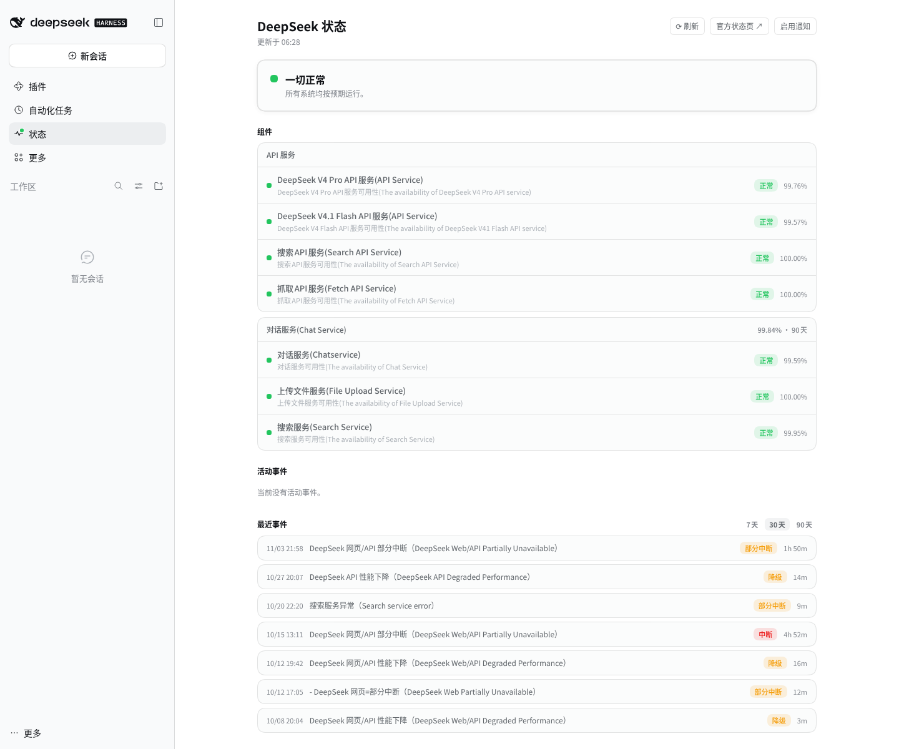

# dsh-deepseek-status

**English** | [简体中文](README.zh.md)

A standalone [DeepSeek Harness](https://github.com/deepseek-ai/deepseek-harness)
(DSH) web plugin for **DeepSeek service status**: a direct bottom-right status
strip, a native full status page, and browser notifications when DeepSeek goes
down or recovers.



## Features

- **Direct status strip** — always visible in the bottom-right corner. When
  `dsh-balance` is installed it sits 8 px above the balance card; without it, it
  sits in the corner itself. It shows the overall state and active-incident
  count, and opens the status page on click.
- **Native status page** — a global `状态` / `Status` entry in the left sidebar
  opens a real DSH main panel: grouped components with 90-day uptime, active
  incident timeline, and recent incidents/maintenance for the last 7/30/90 days.
- **Down/up notifications** — one browser notification on the
  operational ↔ non-operational transition, with a silent baseline on the first
  load and a click that opens the status page. Notifications are optional and
  only fire after permission is granted.
- **No DeepSeek credentials** — the status feed is public, so the plugin works
  without an API key and independently of `dsh-balance`.
- **Not a second card stack** — the status plugin owns one compact strip, not a
  full second card. When the status page is open, the strip and the balance card
  step aside so the page gets the full width.
- **Bilingual and themed** — Chinese/English labels, DSH menu-surface tokens,
  light/dark theme support.

## Requirements

- **DSH 0.2.1.x** with the web profile. Tested with `0.2.1-rc.3`; the package
  declares `engines.dsh = ">=0.2.1-0 <0.2.2-0"`.
- Node.js `^22.19.0 || >=24.0.0` (the DSH requirement).
- Browser notification permission for the DSH site, only if you want the
  down/up notifications.

## Install

Install this repository directly from GitHub:

```bash
dsh plugin --profile web add github:zz0-0/dsh-deepseek-status
systemctl --user restart dsh-web
```

Then **hard-refresh** the DSH web page. The plugin has a host half (status
routes) and a browser half (page, sidebar entry, strip), so it needs the restart
as well as the refresh.

Remove:

```bash
dsh plugin --profile web remove dsh-deepseek-status
systemctl --user restart dsh-web
```

## Using it

- The **left sidebar** gets a `状态` entry with a colored status dot.
- The **bottom-right strip** is the direct glance. Green = operational, amber =
  degraded/partial, red = full outage, blue = maintenance, gray = unknown.
- Clicking the strip or the sidebar entry opens the status page.
- Clicking **启用通知** on the page requests notification permission. Once
  granted, transitions from operational to any incident state, and back to
  operational, produce one browser notification each. Clicking a notification
  opens the status page.
- The page's `7天/30天/90天` buttons switch the recent-history window; `⟳`
  refreshes the summary and the selected history window.

## Placement with `dsh-balance`

The two plugins do not fight for the corner:

- `dsh-balance` keeps its balance card at bottom-right.
- `dsh-deepseek-status` places its strip 8 px above that card.
- While the status page is open, both the strip and the balance card are hidden
  (the page already shows status); returning to a conversation or another panel
  restores them.
- If only `dsh-deepseek-status` is installed, the strip takes the bottom-right
  corner itself and still avoids the composer/status row.

The status feature was removed from `dsh-balance` (0.2.1), so the new plugin is
the single owner of status polling and status UI.

## Data

The host reads the public DeepSeek status page backend (the same JSON its own
status page uses):

| Endpoint | Used for |
|---|---|
| `summary/active` | overall state, page/section/component tree, active changes |
| `summary/structure?start_at_from_seconds=…&start_at_to_seconds=…` | 90-day component/section uptime |
| `change/list?start_at_seconds=…&end_at_seconds=…` | recent incidents/maintenance and their update timelines |

The host polls the active feed at most every 30 seconds and caches structure and
history for five minutes. The browser talks only to the local DSH server:

- `GET /api/deepseek-status/summary`
- `GET /api/deepseek-status/history?days=30`

Component status is derived from the active changes' component statuses; without
an active change, components are operational. Overall status is the worst active
change. Uptime is the status page's own 90-day figure.

Because the status page backend is not a documented API, a failed read yields
`状态未知` (with the official status-page link) rather than a false outage.

## Privacy

- **Outbound requests**: only `status.deepseek.com` (the public status feed and
  its page). No credentials, no API key, no telemetry.
- **Local-only**: the browser requests only the two local `/api/deepseek-status`
  routes.
- **Notifications**: browser notifications are generated locally on status
  transitions; no push service is involved. A closed browser receives none.

## Compatibility

- DSH **0.2.1.x** only, enforced by `engines.dsh`.
- The browser half uses DSH's native `main` panel and `sidebar.panellist` slots,
  the same mechanism as the official Plugins page, plus `locale` and `layout`.
- The status backend is a public third-party service page. The parser is
  defensive and the page shows an explicit unknown state if it changes.

## Development

The plugin has no build step: plain ESM host code and a hand-written
`__ModuleLoader__` browser bundle.

```bash
git clone https://github.com/zz0-0/dsh-deepseek-status.git
cd dsh-deepseek-status
dsh plugin --profile web add link:$(pwd)
systemctl --user restart dsh-web
```

- Host changes (`lib/index.js`, `lib/status.js`) require a `dsh web` restart.
- Browser changes (`lib/client.js`) are served with `Cache-Control: no-store`;
  hard-refresh the page.
- The client bundle registers the page (`main` key `deepseek-status`), the
  sidebar icon (`sidebar.panellist` id `deepseek-status`), and the always-visible
  strip. It polls the host summary every 30 seconds.

### Files

| File | Role |
|---|---|
| `package.json` | DSH bundle + client metadata |
| `cordis.patch.yml` | Inserts the host entry into the web profile |
| `lib/index.js` | Host routes, caching, loopback fence |
| `lib/status.js` | Public status feed fetch + normalization |
| `lib/client.js` | Native page, sidebar entry, direct strip, notifications |
| `screenshot.png` | README screenshot |

## License

[MIT](LICENSE)
