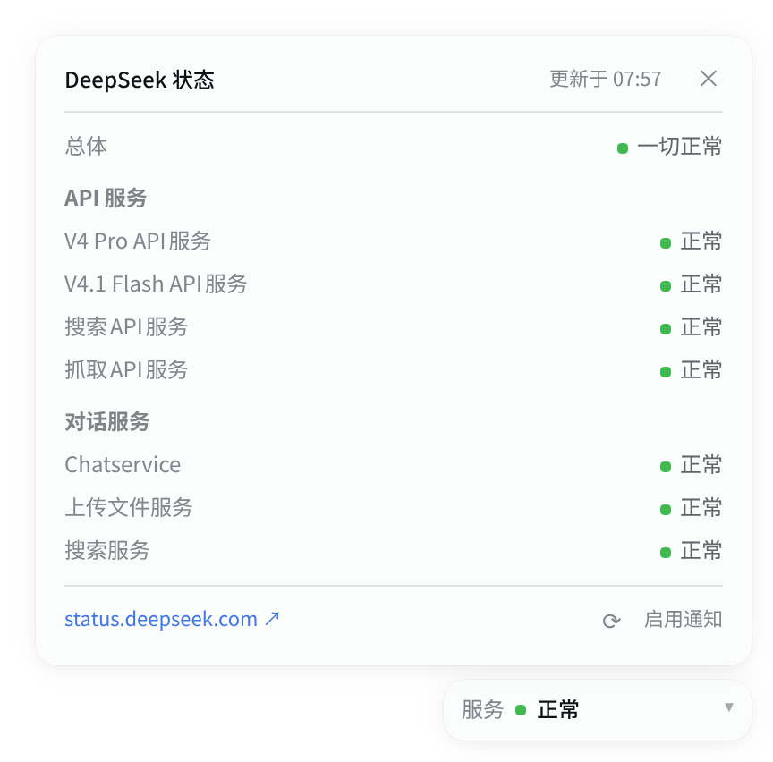

# dsh-deepseek-status

**English** | [简体中文](README.zh.md)

A standalone [DeepSeek Harness](https://github.com/deepseek-ai/deepseek-harness)
(DSH) web plugin that shows **DeepSeek service status** as one compact reading in
the sidebar footer, beside the balance plugin's chip, with a separate popout
panel styled like the balance detail panel and browser notifications when
DeepSeek goes down or recovers.



*Screenshot: the popout panel. The one-line reading it opens from now lives in
the sidebar footer; the capture predates that move.*

## Features

- **Sidebar-footer status chip** — a dot plus `服务` and the current overall
  state, in one 22 px line directly above the Settings trigger, on the same
  26 px line as `dsh-balance`'s chip (left), with the same inherited family and
  the theme's secondary content size. In the 56 px rail the whole line hides,
  and below 768 px it lives in the navigation drawer.
- **Balance-style popout panel** — hover or click the chip and a 400 px panel
  opens above the footer (click pins it; hover away, click the chip again, the
  `×`, outside, or press `Esc` to close). The panel uses the balance detail
  panel's surface, header, rules and two-column layout; the chip itself does
  **not** expand. It lists **every service** and its current state, grouped by
  API / Chat. There are **no descriptions, uptimes, update timelines, or
  recent-events history**; the panel links to the official status page for that
  depth. The panel follows the same skeleton as the balance panel: a header with
  the title, update time and close button, a summary line with the status dot,
  the service grid, and a foot with the official link and the actions.
- **Down/up notifications** — one browser notification on the
  operational ↔ non-operational transition, with a silent first-load baseline.
  Clicking a notification opens the status panel.
- **No credentials** — the status feed is public; works without an API key and
  independently of `dsh-balance`.
- **No sidebar entry, no status page** — the footer chip and its panel are the
  whole UI. `dsh-balance` is left as-is.
- **Bilingual and themed** — Chinese/English labels, DSH menu-surface tokens,
  light/dark theme support.

## Requirements

- **DSH 0.2.x** (0.2.1 and 0.2.2 lines) with the web profile. Tested with
  `0.2.2-rc.1`; the package declares
  `engines.dsh = ">=0.2.1-0 <0.3.0-0"`.
- Node.js `^22.19.0 || >=24.0.0` (the DSH requirement).
- Browser notification permission for the DSH site, only if you want the
  down/up notifications.

## Install

```bash
dsh plugin --profile web add github:zz0-0/dsh-deepseek-status
systemctl --user restart dsh-web
```

Then hard-refresh the DSH page. The plugin has a host half (status routes and the
injected card script), so it needs the restart as well as the refresh.

Remove:

```bash
dsh plugin --profile web remove dsh-deepseek-status
systemctl --user restart dsh-web
```

## Using it, placement, and data

The chip/panel behavior, the shared sidebar-footer row with `dsh-balance`, the
public `summary/active` feed, and the local summary route: [ARCHITECTURE.md](ARCHITECTURE.md).

## Privacy

- **Outbound requests**: only `status.deepseek.com`. No credentials, no API key,
  no telemetry.
- **Local-only**: the browser calls only the local `/api/deepseek-status` routes.
- **Notifications**: generated locally; no push service. A closed browser
  receives none.

## Compatibility

- DSH **0.2.x** (0.2.1 and 0.2.2 lines), enforced by `engines.dsh`.
- The browser side is a classic script injected into the DSH index page, the same
  pattern as `dsh-balance`; no React patch. The chip is appended to the shell's
  `[data-slot="sidebar.footer.action"]` row instead of a floating layer.
- The parser is defensive against changes in the public status page.

## Development

```bash
git clone https://github.com/zz0-0/dsh-deepseek-status.git
cd dsh-deepseek-status
dsh plugin --profile web add link:$(pwd)
systemctl --user restart dsh-web
```

- Host changes (`lib/index.js`, `lib/status.js`) require a `dsh web` restart.
- Browser changes (`lib/client.js`) are served with `Cache-Control: no-store`;
  hard-refresh the page.

### Files

| File | Role |
|---|---|
| `package.json` | DSH bundle metadata |
| `cordis.patch.yml` | Inserts the host entry into the web profile |
| `lib/index.js` | Host routes, caching, loopback fence, client injection |
| `lib/status.js` | Public status feed fetch + normalization |
| `lib/client.js` | Sidebar-footer status chip, popout panel, notifications |
| `screenshot-above.png` | README screenshot |

## License

[MIT](LICENSE)
