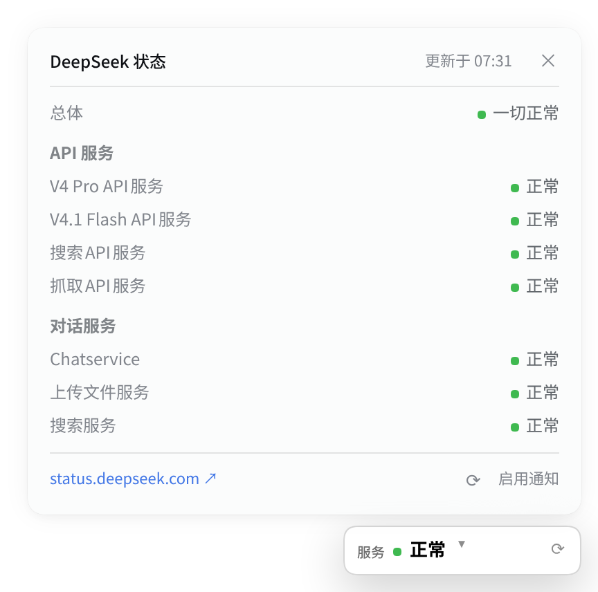

# dsh-deepseek-status

**English** | [简体中文](README.zh.md)

A standalone [DeepSeek Harness](https://github.com/deepseek-ai/deepseek-harness)
(DSH) web plugin that shows **DeepSeek service status** in a **card like the
balance plugin** — always visible in the bottom-right corner, with a separate
popout panel styled like the old balance detail panel and browser notifications
when DeepSeek goes down or recovers.



## Features

- **Balance-style status card** — same surface, typography, padding and width as
  the balance card, collapsed to one line: just `服务` + the current overall
  state. With `dsh-balance` installed it sits 8 px above the balance card;
  without it, it takes the corner itself.
- **Separate old-balance-style popout panel** — click the one-line status card and
  a separate 400 px panel opens above it, using the old balance detail panel's
  surface, header, rules and two-column layout. The one-line status card does
  **not** expand. The panel lists **every service** and its current state, grouped
  by API / Chat. There are **no descriptions, uptimes, update timelines, or
  recent-events history**; the panel links to the official status page for that
  depth. Click the card again, the `×`, outside, or press `Esc` to close it.
- **Down/up notifications** — one browser notification on the
  operational ↔ non-operational transition, with a silent first-load baseline.
  Clicking a notification opens the status panel.
- **No credentials** — the status feed is public; works without an API key and
  independently of `dsh-balance`.
- **No sidebar entry, no status page** — the one-line card and its panel are the
  whole UI. `dsh-balance` is left as-is.
- **Bilingual and themed** — Chinese/English labels, DSH menu-surface tokens,
  light/dark theme support.

## Requirements

- **DSH 0.2.1.x** with the web profile. Tested with `0.2.1-rc.3`; the package
  declares `engines.dsh = ">=0.2.1-0 <0.2.2-0"`.
- Node.js `^22.19.0 || >=24.0.0` (the DSH requirement).
- Browser notification permission for the DSH site, only if you want the
  down/up notifications.

## Install

```bash
dsh plugin --profile web add github:zz0-0/dsh-deepseek-status
systemctl --user restart dsh-web
```

Then hard-refresh the DSH page. The plugin has a host half (status routes and the
injected card script), so it needs the restart as well as the refresh.

Remove:

```bash
dsh plugin --profile web remove dsh-deepseek-status
systemctl --user restart dsh-web
```

## Using it

- The **bottom-right status card** is one line: `服务` + overall state (`正常` /
  `降级` / `部分中断` / `中断` / `维护` / `未知`) + chevron + refresh.
- Click it to open a **separate 400 px popout panel** above the one-line card:
  overall state, all services grouped by API / Chat with their current states,
  and the active incident if any. The one-line card stays one line.
- Close the panel with the card, the `×`, outside click, or `Esc`. The panel's
  `status.deepseek.com ↗` link opens the official page for full detail; the
  `⟳` buttons refresh the summary; `启用通知` requests notification permission.

## Placement with `dsh-balance`

- `dsh-balance` keeps its balance card at bottom-right.
- `dsh-deepseek-status` places its status card 8 px above it.
- Both cards stay visible, and each opens its own detail independently.
- If only `dsh-deepseek-status` is installed, the status card takes the
  bottom-right corner and avoids the composer/status row.

Status was removed from `dsh-balance` (0.2.1), so this plugin is the single owner
of status polling and status UI.

## Data

The host reads the public DeepSeek status page backend:

| Endpoint | Used for |
|---|---|
| `summary/active` | overall state, page/section/component tree, active changes |

The host polls the active feed at most every 30 seconds. The browser only calls
the local summary route:

```text
GET /api/deepseek-status/summary
GET /api/deepseek-status/client.js   # the injected card script
```

The panel lists each component's current state. Overall state is the worst
active change. The panel does not show uptime, descriptions or history;
the official page is the place for that.

The status page backend is not a documented API. A failed read yields
`状态未知` with the official status-page link rather than a false outage.

## Privacy

- **Outbound requests**: only `status.deepseek.com`. No credentials, no API key,
  no telemetry.
- **Local-only**: the browser calls only the local `/api/deepseek-status` routes.
- **Notifications**: generated locally; no push service. A closed browser
  receives none.

## Compatibility

- DSH **0.2.1.x** only, enforced by `engines.dsh`.
- The browser side is a classic script injected into the DSH index page, the same
  pattern as `dsh-balance`; no React patch and no sidebar/page slots.
- The parser is defensive against changes in the public status page.

## Development

```bash
git clone https://github.com/zz0-0/dsh-deepseek-status.git
cd dsh-deepseek-status
dsh plugin --profile web add link:$(pwd)
systemctl --user restart dsh-web
```

- Host changes (`lib/index.js`, `lib/status.js`) require a `dsh web` restart.
- Browser changes (`lib/client.js`) are served with `Cache-Control: no-store`;
  hard-refresh the page.

### Files

| File | Role |
|---|---|
| `package.json` | DSH bundle metadata |
| `cordis.patch.yml` | Inserts the host entry into the web profile |
| `lib/index.js` | Host routes, caching, loopback fence, client injection |
| `lib/status.js` | Public status feed fetch + normalization |
| `lib/client.js` | One-line status card, separate popout panel, notifications |
| `screenshot-panel-dots.png` | README screenshot |

## License

[MIT](LICENSE)
