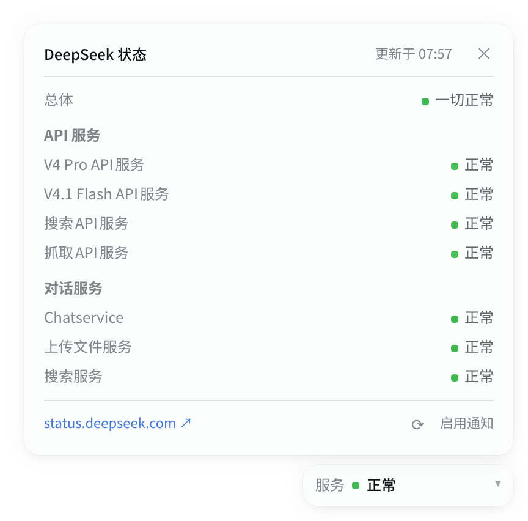

# dsh-deepseek-status

[English](README.md) | **简体中文**

一个独立的 [DeepSeek Harness](https://github.com/deepseek-ai/deepseek-harness)
（DSH）Web 插件：在侧栏底部的一行读数里显示 **DeepSeek 服务状态**，排在余额插件
chip 的右边；悬停或点击会打开一个独立弹层，使用余额插件的详情面板样式；服务中断/恢复
时发送浏览器通知。



*截图是弹层；它现在从侧栏底部的那枚 chip 打开，截图拍于移动之前。*

## 功能

- **侧栏底部状态 chip** — 一个状态点加 `服务` 和当前总体状态，放在和侧栏行同高的
  32px 行里；位于设置上方单独的一行，和 `dsh-balance` 的 chip 共用（余额在左）。
  侧栏收成 56px rail 时整行隐藏；窗口窄于 768px 时位于侧栏抽屉里。
- **独立弹层，余额面板样式** — 悬停或点击 chip，在 footer 上方打开一个 400px 的
  独立弹层（点击可固定；移开、再次点击 chip、点击 `×`、点击外部或按 `Esc` 关闭），
  使用余额详情面板的表面、标题、分隔线和双列布局。chip 本身**不会展开**。弹层列出
  **所有服务**的当前状态，按 API / 对话分组。**不显示描述、可用性、更新记录、
  最近事件历史**；这些请去官方状态页。面板的块序和余额面板一致：标题 + 更新时间 +
  关闭 → 状态摘要（点 + 总体状态）→ 服务明细 → 页脚（官方链接在左、动作在右）。
- **中断/恢复通知** — 仅在「正常 ↔ 非正常」切换时发送一条通知；首次加载只记录
  基线。点击通知打开状态面板。弹层的「启用通知」会向浏览器请求权限；授予后先发一条
  确认通知，按钮随后显示「通知已开启」；被浏览器拒绝时显示「通知被浏览器阻止」。
- **不需要凭据** — 状态源公开，没有 API Key 也能用，独立于 `dsh-balance`。
- **没有侧边栏入口，没有状态页** — 侧栏 footer 的 chip 和弹层就是全部 UI；余额插件
  保持原样。
- **双语、跟随主题** — 中英文界面，使用 DSH 菜单设计变量，支持明暗主题。

## 环境要求

- **DSH 0.2.x**（0.2.1 与 0.2.2 线），并启用 Web profile。已在 `0.2.2-rc.1`
  上测试；包内声明 `engines.dsh = ">=0.2.1-0 <0.3.0-0"`。
- Node.js `^22.19.0 || >=24.0.0`（DSH 的要求）。
- 如需中断/恢复通知，需要为 DSH 站点授予浏览器通知权限。

## 安装

```bash
dsh plugin --profile web add github:zz0-0/dsh-deepseek-status
systemctl --user restart dsh-web
```

然后硬刷新 DSH 页面。插件包含 Host 半（状态路由和注入的卡片脚本），所以既需要
重启也需要刷新。

卸载：

```bash
dsh plugin --profile web remove dsh-deepseek-status
systemctl --user restart dsh-web
```

## 使用、布局与数据来源

chip/面板行为、与 `dsh-balance` 共用的侧栏 footer 行、公开 `summary/active` 源和本地
summary 路由见 [ARCHITECTURE.md](ARCHITECTURE.md)。

## 隐私

- **对外请求**：只有 `status.deepseek.com`。不需要凭据、API Key，也没有遥测。
- **仅本地**：浏览器只请求本地 `/api/deepseek-status` 路由。
- **通知**：本地生成，没有推送服务；浏览器关闭时收不到。

## 兼容性

- 支持 **DSH 0.2.x**（0.2.1 与 0.2.2 线），由 `engines.dsh` 强制。
- 浏览器侧是注入到 DSH 首页的普通脚本，与 `dsh-balance` 同一模式；不修改 React。
  chip 挂在 shell 的 `[data-slot="sidebar.footer.action"]` 行里，不再是浮层。
- 状态页后端属于第三方公开服务页；解析器保持防御性。

## 开发

```bash
git clone https://github.com/zz0-0/dsh-deepseek-status.git
cd dsh-deepseek-status
dsh plugin --profile web add link:$(pwd)
systemctl --user restart dsh-web
```

- Host 改动（`lib/index.js`、`lib/status.js`）需要重启 `dsh web`。
- 浏览器改动（`lib/client.js`）以 `Cache-Control: no-store` 提供，硬刷新页面即可。

### 文件

| 文件 | 作用 |
|---|---|
| `package.json` | DSH bundle 元数据 |
| `cordis.patch.yml` | 把 Host 入口插入 web profile |
| `lib/index.js` | Host 路由、缓存、回环校验、注入客户端脚本 |
| `lib/status.js` | 公开状态源的抓取与归一化 |
| `lib/client.js` | 侧栏 footer 的状态 chip、余额面板样式弹层、通知 |
| `screenshot-above.png` | README 截图 |

## 许可证

[MIT](LICENSE)
