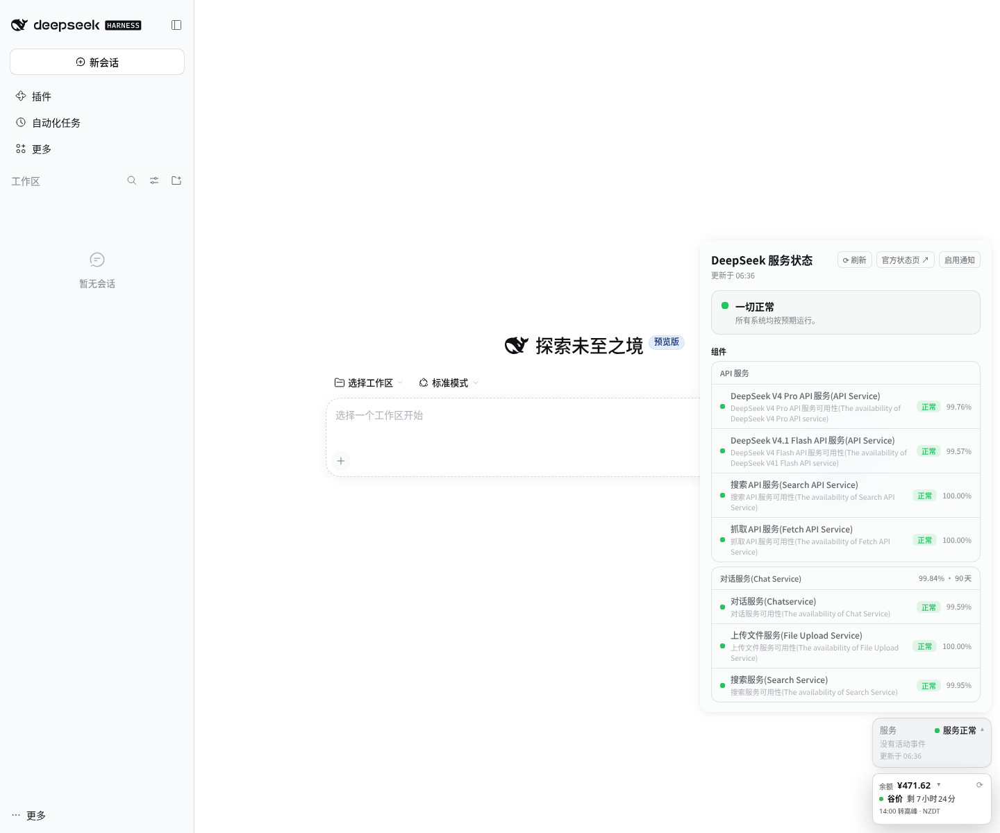

# dsh-deepseek-status

[English](README.md) | **简体中文**

一个独立的 [DeepSeek Harness](https://github.com/deepseek-ai/deepseek-harness)
（DSH）Web 插件：用一个**和余额插件一样的右下角卡片**显示 **DeepSeek 服务状态**，
带详情弹层；服务中断/恢复时发送浏览器通知。



## 功能

- **常驻状态卡片** — 固定在右下角。装有 `dsh-balance` 时，状态卡位于余额卡片
  上方 8px；未安装时自己占据右下角。卡片显示总体状态、活动事件数量和最后更新时间。
- **详情弹层，不是页面** — 点击卡片，在卡片上方打开弹层：总体状态、按分组展示的
  组件与 90 天可用性、活动事件及其更新记录，以及最近 30 天的事件/维护。点击外部
  或按 `Esc` 关闭。
- **中断/恢复通知** — 仅在「正常 ↔ 非正常」切换时发送一条浏览器通知；首次加载只
  记录基线。点击通知会打开状态弹层。
- **不需要 DeepSeek 凭据** — 状态源是公开的，没有 API Key 也能用，独立于
  `dsh-balance`。
- **没有侧边栏入口，没有状态页** — 卡片和弹层就是全部 UI。余额插件继续使用自己的
  卡片和弹层。
- **双语、跟随主题** — 中英文界面，使用 DSH 菜单设计变量，支持明暗主题。

## 环境要求

- **DSH 0.2.1.x**，并启用 Web profile。已在 `0.2.1-rc.3` 上测试；包内声明
  `engines.dsh = ">=0.2.1-0 <0.2.2-0"`。
- Node.js `^22.19.0 || >=24.0.0`（DSH 的要求）。
- 如需中断/恢复通知，需要为 DSH 站点授予浏览器通知权限。

## 安装

直接从 GitHub 安装：

```bash
dsh plugin --profile web add github:zz0-0/dsh-deepseek-status
systemctl --user restart dsh-web
```

然后 **硬刷新** DSH 页面。插件包含 Host 半（状态路由和注入的卡片脚本），所以既需要
重启也需要刷新。

卸载：

```bash
dsh plugin --profile web remove dsh-deepseek-status
systemctl --user restart dsh-web
```

## 使用

- 右下角的 **状态卡片** 是直接入口：绿色正常，黄色降级/部分中断，红色完全中断，
  蓝色维护中，灰色未知。第二行显示活动事件数量，第三行显示 `更新于 HH:MM`。
- 点击卡片打开详情弹层，里面是总体状态、每个组件的 90 天可用性、活动事件及更新
  记录，以及最近 30 天的事件列表。
- 弹层里的 `⟳` 刷新状态和历史；官方状态页链接打开 DeepSeek 完整状态页。
- 点击弹层里的 **启用通知** 请求通知权限。授权后，正常 → 异常、异常 → 正常各发送
  一条通知；点击通知打开状态弹层。
- 点击外部或按 `Esc` 关闭弹层。

## 与 `dsh-balance` 的布局关系

两个插件共用右下角，但不是同一个页面：

- `dsh-balance` 继续在右下角显示余额卡片。
- `dsh-deepseek-status` 的状态卡位于余额卡片上方 8px。
- 两张卡片都可见，各自打开**自己的**详情弹层。
- 如果只安装 `dsh-deepseek-status`，状态卡会自己占据右下角，并避开输入框与
  会话状态行。

服务状态已从 `dsh-balance` 0.2.1 中移除，因此本插件是状态轮询和状态 UI 的
唯一归属。

## 数据来源

Host 读取 DeepSeek 状态页的公开后端（状态页自身使用的同一份 JSON）：

| 接口 | 用途 |
|---|---|
| `summary/active` | 总体状态、页面/分组/组件树、活动变更 |
| `summary/structure?start_at_from_seconds=…&start_at_to_seconds=…` | 90 天组件/分组可用性 |
| `change/list?start_at_seconds=…&end_at_seconds=…` | 最近事件/维护及其更新记录 |

Host 最多每 30 秒拉取一次活动状态；结构与历史缓存 5 分钟。浏览器只访问本地
DSH 服务：

- `GET /api/deepseek-status/summary`
- `GET /api/deepseek-status/history?days=30`
- `GET /api/deepseek-status/client.js` — 注入的卡片脚本

组件状态来自活动变更中的组件状态；没有活动变更时按正常处理。总体状态取最严重的
活动变更。可用性使用状态页自己的 90 天数据。

状态页后端不是正式文档 API，读取失败时显示 `状态未知` 并提供官方状态页链接，
不会伪造「中断」。

## 隐私

- **对外请求**：只有 `status.deepseek.com`（公开状态源和页面）。不需要凭据、
  API Key，也没有遥测。
- **仅本地**：浏览器只请求本地 `/api/deepseek-status` 路由。
- **通知**：浏览器通知在状态切换时本地生成，没有推送服务；浏览器关闭时收不到。

## 兼容性

- 仅支持 **DSH 0.2.1.x**，由 `engines.dsh` 强制。
- 浏览器侧是注入到 DSH 首页的普通脚本，与 `dsh-balance` 同一模式；不修改 React，
  也不注册侧边栏/页面槽位。
- 状态页后端属于第三方公开服务页；解析器保持防御性。

## 开发

没有构建步骤：Host 是普通 ESM，浏览器侧是普通脚本。

```bash
git clone https://github.com/zz0-0/dsh-deepseek-status.git
cd dsh-deepseek-status
dsh plugin --profile web add link:$(pwd)
systemctl --user restart dsh-web
```

- Host 改动（`lib/index.js`、`lib/status.js`）需要重启 `dsh web`。
- 浏览器改动（`lib/client.js`）以 `Cache-Control: no-store` 提供，硬刷新页面即可。
- 注入脚本每 30 秒轮询 Host 摘要，渲染状态卡片和详情弹层。

### 文件

| 文件 | 作用 |
|---|---|
| `package.json` | DSH bundle 元数据 |
| `cordis.patch.yml` | 把 Host 入口插入 web profile |
| `lib/index.js` | Host 路由、缓存、回环校验、注入客户端脚本 |
| `lib/status.js` | 公开状态源的抓取与归一化 |
| `lib/client.js` | 右下角状态卡、详情弹层、通知 |
| `screenshot.png` | README 截图 |

## 许可证

[MIT](LICENSE)
